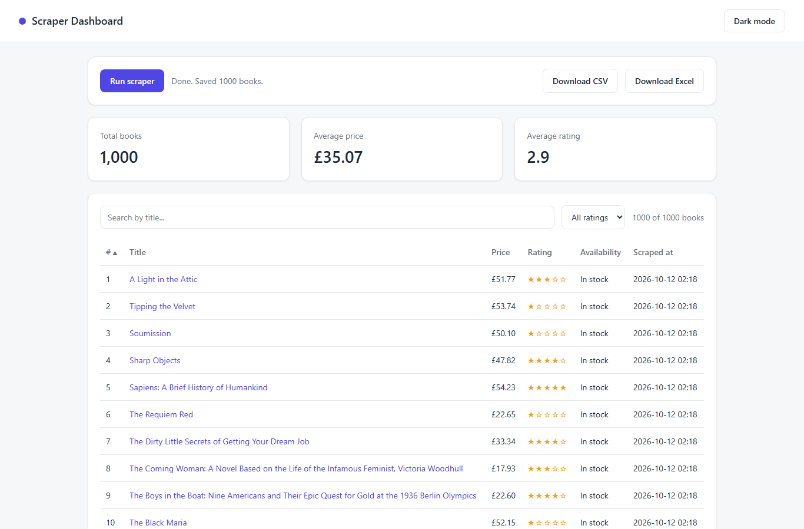
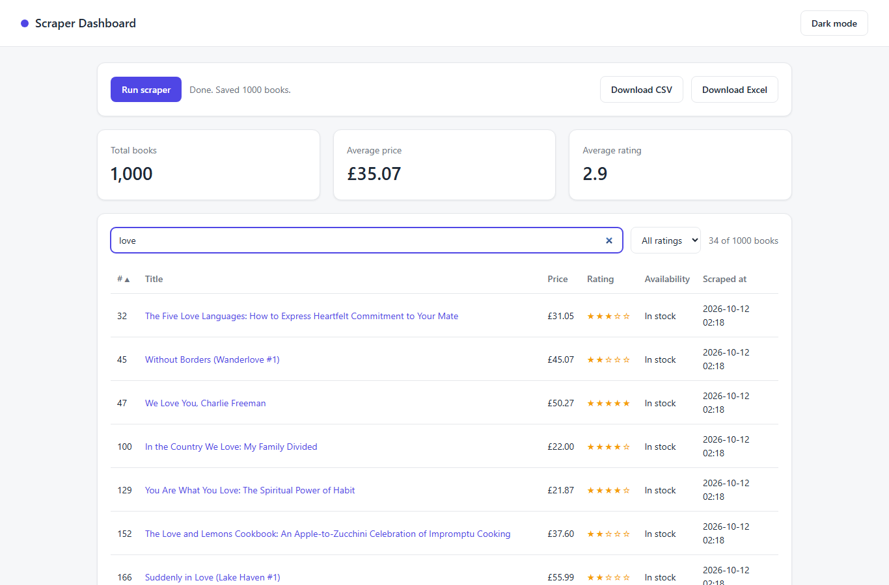
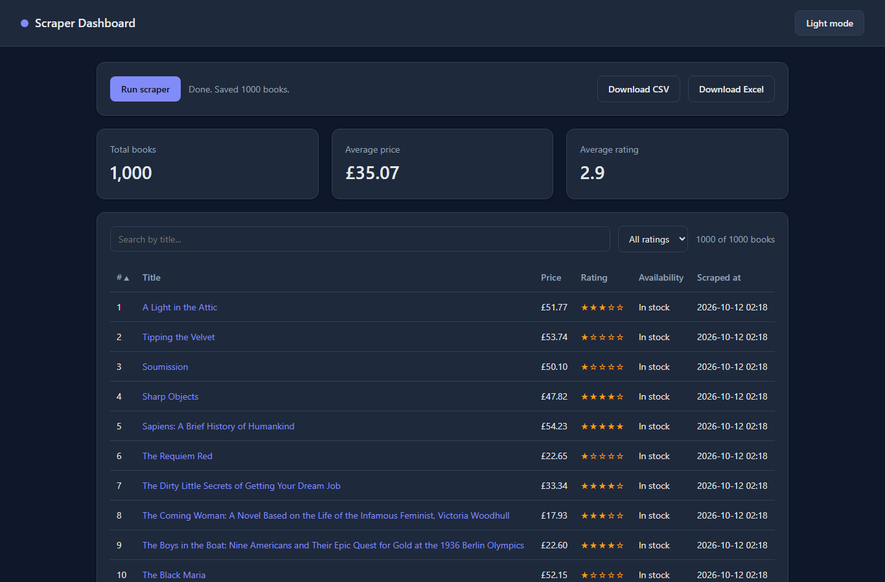

# Scraper Dashboard

A web scraping dashboard built with **Python**. One click launches a real browser, collects data from a website, stores it in a database, and shows the results in a clean, searchable table. The data can be downloaded as CSV or Excel.

The scraper is demonstrated on [books.toscrape.com](https://books.toscrape.com), a sandbox website made for practicing web scraping.

## Screenshots

### Light mode


### Search and filter


### Dark mode


## Features

- **One-click scraping:** a button starts the scraper in the background, with live status updates in the UI
- **Real browser automation:** Playwright (Chromium) loads each page, BeautifulSoup parses the HTML
- **Persistent storage:** results are saved in a SQLite database with SQLAlchemy
- **Interactive table:** search by title, filter by rating, sort by any column, and pagination
- **Export:** download all results as **CSV** or **Excel (.xlsx)**
- **Light and dark mode:** the choice is remembered between visits
- **REST API:** built with FastAPI, with automatic interactive docs at `/docs`

## Tech Stack

| Layer | Tools |
| --- | --- |
| Backend | Python, FastAPI, Uvicorn |
| Scraping | Playwright, BeautifulSoup4 |
| Database | SQLite, SQLAlchemy |
| Export | csv, openpyxl |
| Frontend | HTML, CSS, vanilla JavaScript |

## Getting Started

### 1. Clone the repository

```powershell
git clone https://github.com/ah7484518-droid/scraper-dashboard.git
cd scraper-dashboard
```

### 2. Create and activate a virtual environment

```powershell
py -m venv venv
.\venv\Scripts\Activate.ps1
```

### 3. Install the dependencies

```powershell
pip install -r requirements.txt
python -m playwright install chromium
```

### 4. Run the app

```powershell
uvicorn app.main:app
```

Open [http://127.0.0.1:8000](http://127.0.0.1:8000) in your browser and click **Run scraper**. A full run collects 1,000 books from 50 pages and takes a couple of minutes.

## Project Structure

```
scraper-dashboard/
├── app/
│   ├── main.py        # FastAPI app and API endpoints
│   ├── scraper.py     # Playwright + BeautifulSoup scraper
│   ├── database.py    # SQLAlchemy model and database helpers
│   └── static/
│       ├── index.html # Dashboard page
│       ├── style.css  # Styles (light and dark themes)
│       └── app.js     # Table logic: search, filter, sort, pagination
├── screenshots/       # Images used in this README
├── take_screenshots.py
└── requirements.txt
```

## API Endpoints

| Method | Endpoint | Description |
| --- | --- | --- |
| POST | `/api/scrape` | Start a scraping job in the background |
| GET | `/api/status` | Current status of the scraping job |
| GET | `/api/books` | All scraped books as JSON |
| GET | `/api/export/csv` | Download the results as CSV |
| GET | `/api/export/excel` | Download the results as Excel |

## Notes

- The scraper only targets `books.toscrape.com`, a site built for scraping practice.
- Each new scraping run replaces the previous results, so there are no duplicates.
- Tested on Python 3.15 on Windows.

## Author

Built by [ah7484518-droid](https://github.com/ah7484518-droid) as part of my Python Full-Stack and Web Automation portfolio.